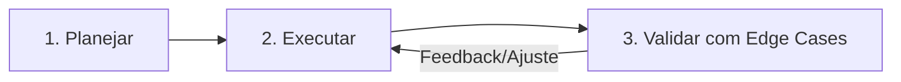

# Padrões de Código e Regras Inegociáveis - Kairós

Este documento estabelece as diretrizes obrigatórias de engenharia de software para qualquer intervenção ou contribuição no projeto Kairós.

---

## 0. Regra Padrão: Filosofia Ponytail (Desenvolvimento Minimalista & Pragmático)

Em todas as tarefas, o agente deve agir como o "Lazy Senior Developer":
- **Mantra:** *"O melhor código é aquele que você nunca precisou escrever."*
- **Escada da Preguiça:**
  1. *YAGNI:* Questione se a funcionalidade realmente precisa existir agora.
  2. *Reúso:* Verifique se a lógica já existe no repositório (`lib/controllers/`, `lib/services/`, etc.).
  3. *APIs Nativas:* Use a biblioteca padrão do Dart/Flutter ou Python antes de inventar helpers customizados.
  4. *Zero Dependências Extras:* Nunca adicione pacotes ao `pubspec.yaml` ou `requirements.txt` sem justificativa cabal.
  5. *Edições Cirúrgicas:* Altere apenas o necessário, mantendo o menor footprint de código possível sem violar segurança, acessibilidade e robustez.

---

## 1. Regra 1: Compatibilidade Estrita Multiplataforma (Android & Web)

O Kairós é compilado tanto para APK nativo Android quanto para Web (Wasm/CanvasKit/HTML). Quebras de compilação na Web por uso inadequado de APIs de I/O são estritamente inaceitáveis.

### Diretrizes:
1. **Zero Imports Diretos de `dart:io` em Código Compartilhado**:
   - Nunca importe `dart:io` em telas, controllers ou modelos compartilhados.
   - O simples import de `dart:io` em arquivos compilados para a Web causará erro em tempo de compilação (`dart:io is not available on this platform`).
2. **Uso de Imports Condicionais**:
   - Sempre isole código dependente de sistema operacional usando a sintaxe de imports condicionais do Dart:
     ```dart
     import 'feature_stub.dart'
         if (dart.library.js_interop) 'feature_web.dart'
         if (dart.library.io) 'feature_io.dart';
     ```
3. **Verificação com `kIsWeb`**:
   - Quando lógica simples puder conviver no mesmo arquivo sem imports restritos, use `if (kIsWeb) { ... } else { ... }`.
4. **Armazenamento e Rede**:
   - Utilize abstrações compatíveis com IndexedDB na Web e SQLite FFI no Android (conforme implementado em `lib/core/database/`).

---

## 2. Regra 2: Responsividade Obrigatória e Suporte a Diferentes DPIs

O aplicativo opera em múltiplos formatos de exibição: smartphones compactos, celulares modernos de tela longa (20:9), tablets e monitores desktop com navegadores de tela cheia ou janelas redimensionadas.

### Diretrizes:
1. **Proibição de Dimensões Rígidas/Hardcoded**:
   - Nunca use larguras ou alturas absolutas fixas em contêineres principais (ex: `width: 400`, `height: 800`) sem limites elásticos.
   - Nunca construa layouts horizontais ou verticais sem gerenciar overflow.
2. **Uso Mandatório de Estruturas Elásticas**:
   - Utilize `LayoutBuilder` para tomar decisões estruturais com base nos `BoxConstraints` disponíveis.
   - Utilize `MediaQuery.sizeOf(context)` e `MediaQuery.paddingOf(context)` para margens seguras e cálculo proporcional.
   - Envolva filhos de `Row` e `Column` com `Flexible` ou `Expanded` quando houver conteúdo textual ou expansível.
3. **Prevenção Ativa de RenderFlex Overflow**:
   - Telas com formulários ou listas de cartões devem obrigatoriamente suportar rolagem (`SingleChildScrollView`, `ListView` ou `CustomScrollView`) para comportar teclados virtuais e DPIs elevados.
4. **Respeito ao `TextScaler` e Acessibilidade**:
   - O texto não pode ser cortado quando o usuário aumentar o tamanho de fonte do sistema ou do app.
   - Utilize `maxLines` acompanhado de `overflow: TextOverflow.ellipsis` quando o truncamento for proposital, ou permita quebra de linha fluida.
   - Em diálogos modais e bottom sheets, limite a largura máxima com `ConstrainedBox(constraints: BoxConstraints(maxWidth: 600))` para manter elegância no navegador Web Desktop.

---

## 3. Regra 3: Ciclo Agêntico Obrigatório em Malha Fechada

Qualquer modificação no repositório deve obrigatoriamente seguir as 3 etapas sequenciais:



### 3.1 Etapa 1: Planejar (Aprovação Prévia)
- Antes de editar arquivos de produção, apresentar ao usuário:
  1. Diagnóstico da causa raiz do problema ou objetivo claro da melhoria.
  2. Lista exata dos arquivos que serão modificados ou criados.
  3. Abordagem técnica proposta e potenciais impactos colaterais.
- Aguardar o consentimento do usuário antes de iniciar a escrita no código de produção.

### 3.2 Etapa 2: Executar
- Realizar alterações atômicas, pontuais e aderentes aos padrões de arquitetura identificados no `project_context.md`.
- Preservar a documentação existente, docstrings e comentários pertinentes.

### 3.3 Etapa 3: Validar com Edge Cases
- Nenhuma tarefa é dada como concluída sem validação ativa:
  1. **Análise Estática Flutter**: Executar `flutter analyze` garantindo zero erros ou novos avisos.
  2. **Testes de Unidade Flutter**: Executar `flutter test` garantindo regressão zero.
  3. **Validação de Scripts Python**: Executar compilação de sintaxe (`python -m py_compile scripts/<script>.py`) e validação de imports/tipagem.
  4. **Inspeção de Casos de Borda**:
     - *Flutter*: Verificar comportamento com fontes ampliadas (`TextScaler`), telas estreitas (<360dp) e telas largas (>1200dp).
     - *Python / CI*: Verificar comportamento sob falhas de rede, respostas vazias da API, timeouts e credenciais ausentes em dry-run.
