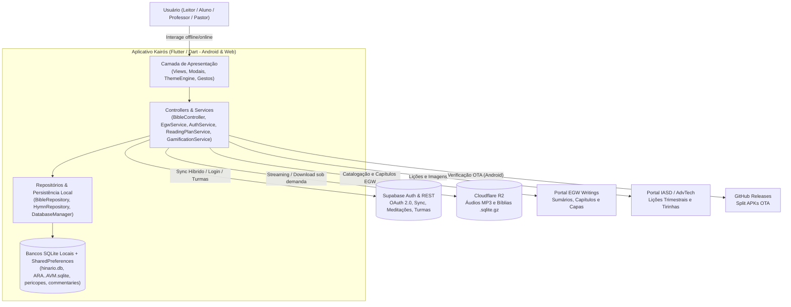
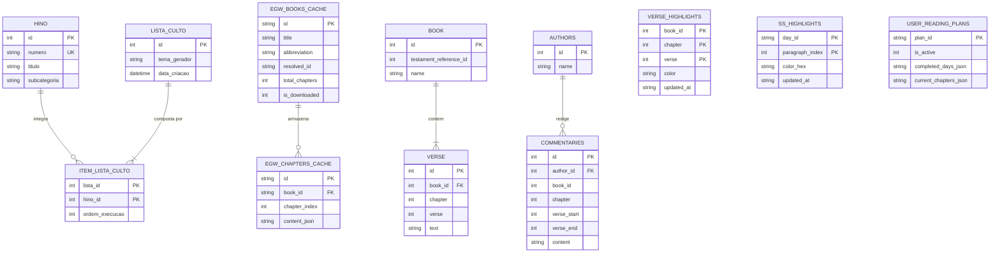
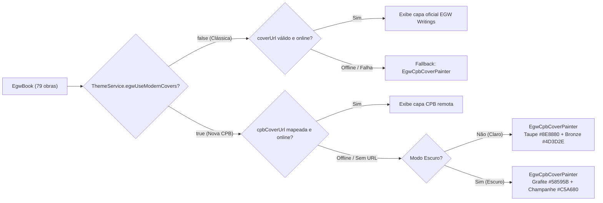

# 02 — Arquitetura e Projeto do Sistema — Kairós

> **Escopo Técnico:** Arquitetura de Software da aplicação multiplataforma **Kairós** em Flutter/Dart (`package:kairos_web`), detalhando organização de camadas, persistência SQLite multiplataforma, diagramas estruturais (C4, Classes, DER Multi-Banco) e fluxos comportamentais críticos.

---

## 1. Visão Arquitetural e Princípios de Engenharia

O **Kairós** adota uma **Arquitetura em Camadas Desacopladas (Layered Clean-Inspired Architecture)** orientada pela **Filosofia Ponytail** (pragmatismo minimalista descrito em [`AGENTS.md`](../AGENTS.md)):
- **Gerenciamento de Estado Nativo:** Uso exclusivo de `ChangeNotifier`, `ValueNotifier`, `ListenableBuilder` e `AnimatedBuilder` da biblioteca padrão do Flutter, evitando sobrecarga de frameworks externos de estado.
- **Abstração Multiplataforma em Tempo de Compilação:** O acesso a sistema de arquivos (`dart:io`), servidor loopback OAuth, notificações locais, compartilhamento/download e drivers SQLite (`sqlite3` FFI no Android vs. WASM/IndexedDB na Web) é isolado atrás de **Conditional Imports** (`*_stub.dart` / `*_io.dart` / `*_web.dart`).
- **Offline-First com Sync Híbrido:** Todos os dados essenciais (Bíblia, Perícopes, Comentários, Referências Cruzadas, Hinários, Planos, Progresso EGW e Destaques) residem localmente em SQLite / `SharedPreferences`, sendo mesclados de forma não-destrutiva quando o usuário autentica via Supabase.

### 1.1 Organização de Diretórios (`lib/`)

```text
lib/
├── main.dart                     # Ponto de entrada, inicialização de serviços e rotas
├── core/
│   ├── config/app_config.dart    # Configurações de build (--dart-define), Supabase & R2
│   ├── constants/                # Constantes globais, nomes de bancos e fontes
│   ├── database/                 # DatabaseManager + implementações IO / Web / Stub
│   ├── theme/app_theme.dart      # 11 AppThemeStyle, KairosPalette, Glass/RealGlass/Win95
│   └── utils/                    # BibleExtractor, EgwExtractor, VerseCardRenderer, XlsxBuilder
├── models/                       # Entidades de domínio (EgwBook, BibleVerse, Pericope, Commentary...)
├── data/
│   ├── repositories/             # BibleRepository, HymnRepository, PericopeRepository, CommentaryRepository...
│   └── services/                 # SabbathSchoolService
├── controllers/                  # BibleController, HymnController, DevotionalController, QuizController, SabbathSchoolController
├── services/                     # AuthService, EgwService, GamificationService, ReadingPlanService, ThemeService, SolarService...
├── widgets/                      # Componentes transversais reutilizáveis (KairosReaderGestureLayer)
└── views/                        # Camada de apresentação modularizada por domínio funcional
```

---

## 2. Arquitetura de Contexto e Containers (Modelo C4)



---

## 3. Diagrama de Classes da Arquitetura

> **Diagrama UML Formal:** [`docs/diagramas/Diagrama_de_Classes.puml`](./diagramas/Diagrama_de_Classes.puml)

```mermaid
classDiagram
    class DatabaseManager {
        +static List~String~ userPreservedTables
        +getDatabase(dbName) Future~CommonDatabase~
        +dispose() void
    }

    class ThemeService {
        +AppThemeStyle themeStyle
        +bool egwUseModernCovers
        +bool gesturesEnabled
        +bool gestureSwipeChapters
        +bool gesturePinchFont
        +bool gestureDoubleTapHighlight
        +bool isAnyGlass
        +bool isRealGlass
        +bool isHoloRetro
        +bool isWin95
        +setThemeStyle(style) Future~void~
        +setEgwUseModernCovers(val) Future~void~
    }

    class EgwService {
        +static List~Map~ defaultCatalog
        +shouldBypassTocCache(...) bool
        +getTableOfContents(bookId, forceRefresh) Future~List~
        +downloadBook(bookId, onProgress) Future~void~
        +isBookDownloaded(bookId) Future~bool~
    }

    class EgwBook {
        +String id
        +String title
        +String abbreviation
        +String coverUrl
        +String? cpbCoverUrl
        +String? resolvedId
        +int totalChapters
        +int downloadedChapters
        +bool isDownloaded
        +static evaluateDownloadCompleteness(...) bool
    }

    class BibleRepository {
        +String activeVersion
        +getBooks() Future~List~BibleBook~~
        +getVerses(bookId, chapter) Future~List~BibleVerse~~
        +static resolveBookIdByAlias(name) int?
        +syncHighlightsFromCloud() Future~void~
    }

    class PericopeRepository {
        +getPericopesForChapter(bookId, chapter) Future~List~Pericope~~
    }

    class CommentaryRepository {
        +getCommentariesForVerse(bookId, chapter, verse) Future~List~Commentary~~
    }

    class SabbathSchoolService {
        +getHighlights(dayId) Future~Map~
        +saveHighlight(dayId, idx, colorHex) Future~void~
        +removeHighlight(dayId, idx) Future~void~
        +exportHighlightsForSync() Future~List~
        +importHighlightsWithMerge(cloudItems) Future~void~
    }

    class ReadingPlanService {
        +completeEgwMissionStep(planId, dayIndex, mission) Future~void~
        +mergeCloudPlans(cloudPlans) Future~void~
        +exportPlansForCloud() List~Map~
    }

    class GamificationService {
        +static mergeActivityDates(local, remote) Set~String~
        +mergeCloudMetadata(meta) Future~bool~
        +addOilDrops(amount, source) Future~void~
    }

    class AuthService {
        +bool isAuthenticated
        +syncPreferencesToCloud(...) Future~bool~
    }

    class KairosReaderGestureLayer {
        +Widget child
        +VoidCallback? onNextChapter
        +VoidCallback? onPreviousChapter
        +ValueChanged~double~? onFontScaleDelta
    }

    BibleRepository --> DatabaseManager
    PericopeRepository --> DatabaseManager
    CommentaryRepository --> DatabaseManager
    SabbathSchoolService --> DatabaseManager
    EgwService --> DatabaseManager
    EgwService --> EgwBook
    AuthService --> ThemeService
    AuthService --> GamificationService
    AuthService --> ReadingPlanService
    AuthService --> SabbathSchoolService
    AuthService --> BibleRepository
    ReadingPlanService --> GamificationService
    KairosReaderGestureLayer --> ThemeService
```



---

## 4. Projeto de Dados: DER Multi-Banco SQLite

> **Diagrama DER Formal:** [`docs/diagramas/DER_MultiBanco.puml`](./diagramas/DER_MultiBanco.puml)

O armazenamento local do Kairós é particionado por domínio para evitar acoplamento entre conteúdo estático empacotado e estado dinâmico do usuário, otimizando o tamanho dos pacotes APK e do bundle Web.

### 4.1 Inventário Real de Bancos Empacotados em `assets/`

| Banco SQLite | Finalidade | Tabelas Principais e Volumes Verificados |
| :--- | :--- | :--- |
| **`assets/hinario.db`** | Banco principal R/W (Hinário Novo + Estado Preservado + FTS5 + Cache SS/EGW) | `hino` (601), `hino_fts` (601), `tema` (15), `texto_biblico` (1178), `biblia_fts` (31104), `meditacao_fts` (62), `licao_fts` (137), `ss_quarterlies` (34), `ss_lessons` (39), `ss_days` (137), `verse_highlights`, `ss_highlights`, `ss_user_notes`, `ss_question_answers`, `user_reading_plans`, `egw_books_cache`, `egw_chapters_cache`, `user_gamification` |
| **`assets/hinario_antigo.db`** | Hinário Adventista Tradicional (1996) | `hino` (613), `hino_fts` (613), `tema` (52), `hino_tema` (1199), `texto_biblico` (440) |
| **`assets/hinario_comparativo.db`** | Comparação entre edições 1996 e 2022 | `comparativo_hinos` (873), `comparativo_fts` (873) |
| **`assets/ARA.sqlite`** (e `NVI`, `NTLH`, `KJA`, `AS21`, `AVM`) | Traduções bíblicas (bundle + download R2) | `book` (66 canônicos; 73+1 na `AVM`), `verse` (~31.102–31.104 por tradução canônica), `metadata` |
| **`assets/pericopes.sqlite`** | Subtítulos literários das seções bíblicas | `pericope` (1461 registros: `book_id`, `chapter`, `verse`, `title`) |
| **`assets/commentaries.sqlite`** | Comentários expositivos multi-autor | `authors` (3 autores), `commentaries` (45 registros por intervalo `verse_start..verse_end`) |
| **`assets/cross_references.sqlite`** | Referências bíblicas cruzadas | `cross_reference` (386 registros direcionados com pontuação `votes`) |

### 4.2 Diagrama Entidade-Relacionamento (DER Consolidado)



### 4.3 Mecanismo de Migração Segura e Preservação de Dados (`DatabaseManager`)
Quando um novo asset de `hinario.db` é empacotado em uma atualização do app:
1. `sqliteVersionMarker(ByteData)` combina o tamanho em bytes e o *file change counter* (bytes `24..27` do cabeçalho SQLite) para detectar alterações sem depender de números de versão manuais.
2. Caso o marcador difira do arquivo `.ver` gravado no dispositivo, `DatabaseManager` executa `PRAGMA wal_checkpoint(TRUNCATE);`, extrai todas as tabelas listadas em `userPreservedTables` (incluindo `ss_highlights`, `verse_highlights`, `user_reading_plans`, `egw_books_cache`, `egw_chapters_cache`, `user_gamification` etc.) via `dumpUserTables()`, substitui o banco base e restaura os dados do usuário por interseção de colunas com `restoreUserTables()`.

---

## 5. Fluxos Críticos de Engenharia (Diagramas de Sequência)

### 5.1 Sincronização Híbrida na Nuvem (`AuthService` + Merge Determinístico)

```mermaid
sequenceDiagram
    actor U as Usuário
    participant A as AuthService
    participant S as Supabase Auth / REST
    participant G as GamificationService
    participant P as ReadingPlanService
    participant SS as SabbathSchoolService
    participant B as BibleRepository

    U->>A: Conclui login OAuth / E-mail ou restaura sessão
    A->>S: GET /auth/v1/user (metadados remotos)
    S-->>A: AuthUser (rawMetadata)
    A->>G: mergeCloudMetadata(meta)
    Note over G: Set.union em activityDates e troféus; max() para XP e streak
    A->>P: mergeCloudPlans(rawPlans)
    Note over P: Set.union em completedDays e currentDayCompletedChapters
    A->>SS: importHighlightsWithMerge(rawSsHighlights)
    Note over SS: Last-write-wins por updated_at em ss_highlights
    A->>B: syncHighlightsFromCloud()
    Note over B: GET /rest/v1/verse_highlights e merge no SQLite local
    A->>S: PUT /auth/v1/user (push consolidado de volta à nuvem)
```

### 5.2 Renderização Dual de Capas EGW e Proteção contra Cache Parcial



---

## 6. Subsistema Visual e Camada de Gestos

### 6.1 Motor de Temas (`AppThemeStyle` — 11 Estilos)
Definido em `lib/core/theme/app_theme.dart` e orquestrado por `ThemeService`:
- **Clássicos e Adaptativos:** `materialYou`, `classicBook`, `classicBookNew` (*Pergaminho Editorial*), `aurora`, `oledVivid`, `zen`.
- **Vidro e Refração:** `liquidGlass` e `appleGlass` (preservados integralmente) e **`realGlass`** (`RealGlassSurface` combinando `ImageFilter.blur` e `ImageFilter.matrix` refrativa + dispersão cromática em sombras azul/rosa).
- **Temas Retrô:** **`holoRetro`** (*Retrô ICS Holo*, inspiração Android 4.0 `#33B5E5` com quinas retas) e **`win95`** (*Windows 95*, fundo `#008080`, cinza `#C0C0C0`, barras `#000080` e `Win95BevelBox`).

### 6.2 Camada Unificada de Gestos (`KairosReaderGestureLayer`)
Envolve os 5 leitores principais do aplicativo (`BibleReaderView`, `BibleImmersiveView`, `SabbathSchoolView`, `EgwReaderView`, `HymnDetailView`). Quando `ThemeService.gesturesEnabled` é `false`, retorna diretamente `widget.child` sem registrar detectores de gesto, evitando interceptações indesejadas em leitores de tela ou acessibilidade motora. Quando ativo, respeita individualmente:
- `gestureSwipeChapters`: `GestureDetector` horizontal com limiar de velocidade (`primaryVelocity.abs() > 350.0`) para não conflitar com a rolagem vertical;
- `gesturePinchFont`: rastreamento de 2 ponteiros (`PointerDownEvent`/`PointerMoveEvent`) com clamp seguro de multiplicador (`0.8..1.6`);
- `gestureDoubleTapHighlight`: duplo toque para alternar grifo no versículo/parágrafo.
