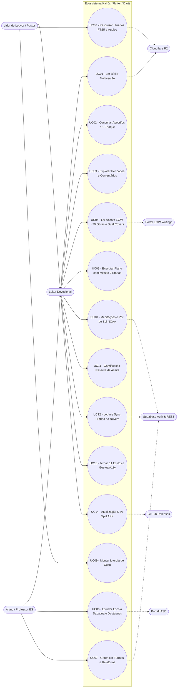
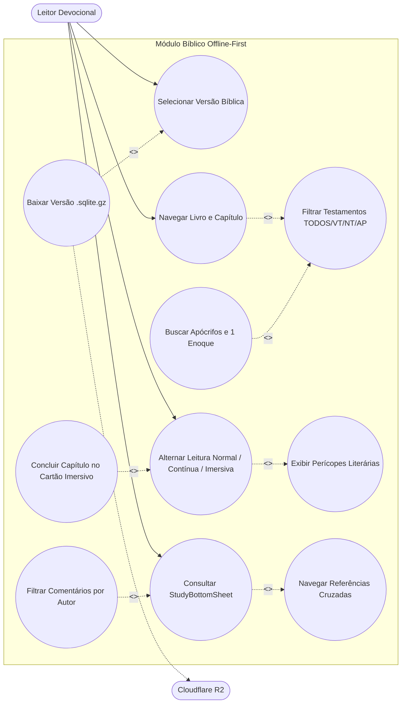
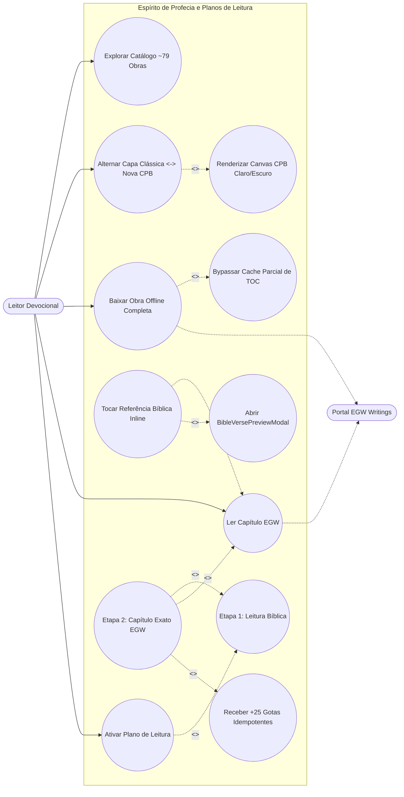
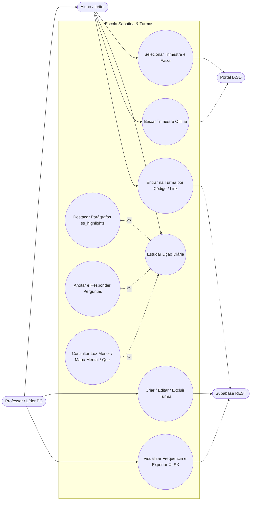
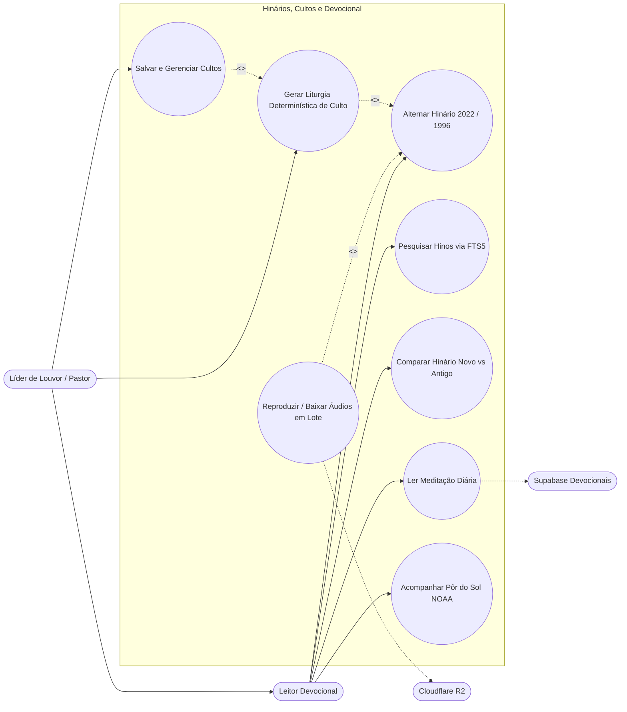
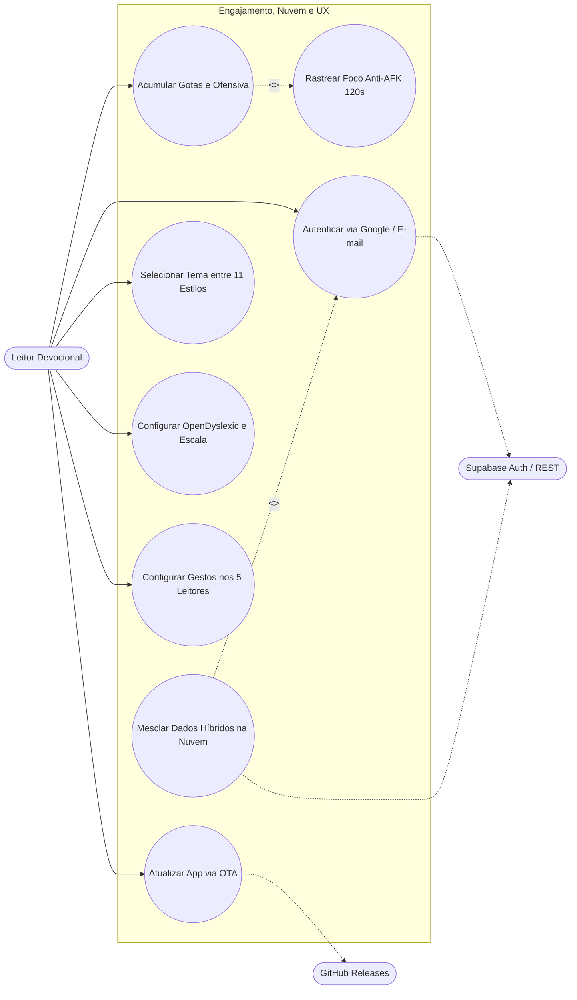

# 03 — Diagramas e Especificações de Casos de Uso (UML 2.5) — Kairós

> **Notação:** Diagramas visuais em Mermaid (renderização nativa no GitHub) acompanhados de modelos formais em PlantUML (`docs/diagramas/*.puml`) e Tabelas de Especificação Completa de Casos de Uso.

---

## 1. Diagrama Geral de Casos de Uso (Ecossistema Completo)

> **Arquivo PlantUML:** [`docs/diagramas/DCU_Geral.puml`](./diagramas/DCU_Geral.puml)

---

## 2. Diagramas de Casos de Uso por Módulo

### 2.1 DCU 01 — Estudo Bíblico, Apócrifos/1 Enoque, Perícopes e Comentários
> **Arquivo PlantUML:** [`docs/diagramas/DCU01_Biblia_Apocrifos_Estudo.puml`](./diagramas/DCU01_Biblia_Apocrifos_Estudo.puml)

### 2.2 DCU 02 — Espírito de Profecia (~79 Obras) & Missão Diária em 2 Etapas
> **Arquivo PlantUML:** [`docs/diagramas/DCU02_EGW_Planos_Missao.puml`](./diagramas/DCU02_EGW_Planos_Missao.puml)

### 2.3 DCU 03 — Escola Sabatina Interativa & Gestão de Turmas/Classes
> **Arquivo PlantUML:** [`docs/diagramas/DCU03_Escola_Sabatina_Turmas.puml`](./diagramas/DCU03_Escola_Sabatina_Turmas.puml)

### 2.4 DCU 04 — Hinários Adventistas, Agente de Cultos & Devocional
> **Arquivo PlantUML:** [`docs/diagramas/DCU04_Hinarios_Cultos_Devocional.puml`](./diagramas/DCU04_Hinarios_Cultos_Devocional.puml)

### 2.5 DCU 05 — Gamificação, Sync Híbrido na Nuvem, Temas & Acessibilidade
> **Arquivo PlantUML:** [`docs/diagramas/DCU05_Gamificacao_Sync_Temas.puml`](./diagramas/DCU05_Gamificacao_Sync_Temas.puml)

---

## 3. Especificações Textuais Formais dos Casos de Uso Críticos

### 3.1 UC-02: Buscar e Ler Livros Deuterocanônicos (`AVM`) e `1 Enoque` (`book_id = 74`)
| Campo | Descrição |
| :--- | :--- |
| **Identificador / Nome** | UC-02 — Consultar Livros Deuterocanônicos (`AVM`) e `1 Enoque` |
| **Atores** | Leitor Devocional (Primário) |
| **Pré-condições** | Versão bíblica `AVM.sqlite` (ou versão contendo Enoque) instalada localmente ou disponível via `ContentManager`. |
| **Fluxo Principal** | 1. O usuário abre o seletor `BookChapterSelectorSheet` na tela da Bíblia. 2. O usuário seleciona a aba de filtro `Apócrifos` (`AP`) ou digita o nome do livro (ex.: `"I Macabeus"`, `"Eclesiástico"`, `"1 Enoque"`). 3. `BookChapterSelectorSheet.normalizeText` remove diacríticos e normaliza numerais romanos (`I` $\rightarrow$ `1`, `II` $\rightarrow$ `2`). 4. `BookChapterSelectorSheet.matchesFilter` valida que o livro pertence ao conjunto apócrifo/extra-canônico (`isApocryphalBook` / `isEnoch`) ou corresponde à busca em `TODOS`. 5. O usuário toca no livro e escolhe o capítulo desejado; `BibleRepository.getVerses` carrega o texto no leitor. |
| **Fluxos Alternativos** | **FA01 (Busca por referência textual):** Ao clicar em uma referência de texto como `"Sirácida 2:1"`, `BibleRepository.resolveBookIdByAlias` resolve o ID correto (`67..74`). **FA02 (Aba TODOS sem consulta):** Com o campo de busca vazio na aba `TODOS`, `isEnoch` mantém `1 Enoque` oculto para preservar a ordenação canônica padrão, exibindo-o assim que o usuário pesquisa `"enoque"` ou entra na aba `AP`. |
| **Fluxos de Exceção** | **FE01 (Módulo não baixado):** Se a versão `AVM` não estiver instalada na Web/Android, `ContentManager` inicia o download e, caso o host primário falhe na Web, tenta as URLs alternativas de `buildFallbackUrls`. |
| **Pós-condições** | O capítulo selecionado é renderizado com perícopes e suporte a grifos e estudo. |

---

### 3.2 UC-04: Download Offline Íntegro e Sistema Dual de Capas no Acervo EGW
| Campo | Descrição |
| :--- | :--- |
| **Identificador / Nome** | UC-04 — Baixar Obra EGW Offline com Validação Real e Alternar Capas Clássica/CPB |
| **Atores** | Leitor Devocional (Primário), Portal EGW Writings (Externo) |
| **Pré-condições** | Catálogo carregado com as 79 obras de `EgwService.defaultCatalog`. |
| **Fluxo Principal** | 1. O usuário acessa *Espírito de Profecia* (`EgwBooksView`). 2. O sistema renderiza cada obra usando `EgwBookCover`, observando `ThemeService.egwUseModernCovers`. 3. O usuário alterna o modo de capas (*Capa Clássica* $\leftrightarrow$ *Capa CPB*) na barra superior. 4. Se o modo *Nova CPB* estiver ativo sem URL remota ou sem conexão, `EgwCpbCoverPainter` desenha a capa procedural minimalista adaptada ao tema claro (Taupe `#8E8880` / Bronze `#4D3D2E`) ou escuro (Grafite `#58595B` / Champanhe `#C5A680`). 5. O usuário solicita o download offline de uma obra. 6. `EgwService.downloadBook` chama `getTableOfContents(bookId, forceRefresh: true)` aplicando `shouldBypassTocCache` para evitar truncamento por cache online parcial de 1 capítulo. 7. O sistema grava `total_chapters` em `egw_books_cache`, baixa todos os capítulos faltantes para `egw_chapters_cache` e valida via `EgwBook.evaluateDownloadCompleteness` antes de marcar `is_downloaded = 1`. |
| **Fluxos Alternativos** | **FA01 (Referência bíblica durante a leitura):** Ao ler qualquer capítulo em `EgwReaderView`, o usuário toca em uma citação bíblica sublinhada (`EgwLinkableParagraph`), abrindo `BibleVersePreviewModal` sem sair do livro. |
| **Fluxos de Exceção** | **FE01 (Queda de conexão durante download):** Capítulos faltantes impedem a gravação de `is_downloaded = 1`; `isBookDownloaded` retorna `false` até o término completo. |
| **Pós-condições** | A obra completa torna-se acessível 100% offline e sua preferência visual de capa é sincronizada em `ThemeService`. |

---

### 3.3 UC-05: Missão Diária Integrada em 2 Etapas nos Planos de Leitura
| Campo | Descrição |
| :--- | :--- |
| **Identificador / Nome** | UC-05 — Cumprir Missão Diária em 2 Etapas (Bíblia $\rightarrow$ Capítulo Exato EGW) |
| **Atores** | Leitor Devocional (Primário) |
| **Pré-condições** | Plano de leitura ativo em `ReadingPlanService` cujo dia possua sugestão ou nota EGW válida. |
| **Fluxo Principal** | 1. O usuário abre os detalhes do plano (`_PlanDetailsBottomSheet`) ou acompanha pela pílula flutuante (`ReadingPlanFloatingPill`). 2. O sistema exibe **Etapa 1 (Leitura Bíblica)** e **Etapa 2 (Espírito de Profecia — Cap. X)** derivadas por `ReadingPlanDay.parseEgwMission()`. 3. O usuário conclui os capítulos bíblicos da Etapa 1. 4. O usuário toca na Etapa 2; o sistema abre `EgwReaderView(bookId: mission.bookId, initialChapterNumber: mission.chapterNumber)` posicionado diretamente no capítulo alvo do sumário. 5. Ao concluir a leitura, o usuário aciona a conclusão da missão. 6. `ReadingPlanService.completeEgwMissionStep` registra `mission.stepKey` (`egw:<CODE>:<CAP>`) em `currentDayCompletedChapters` e concede `+25` gotas via `GamificationService.addOilDrops`. |
| **Fluxos Alternativos** | **FA01 (Re-execução no mesmo dia):** Se `mission.stepKey` já constar em `currentDayCompletedChapters`, o método retorna de forma idempotente sem duplicar XP. |
| **Fluxos de Exceção** | **FE01 (Livro EGW ainda não cacheado e usuário offline):** `EgwReaderView` exibe estado amigável informando a necessidade de conexão para o primeiro carregamento do capítulo. |
| **Pós-condições** | Etapa 2 marcada no progresso diário (`user_reading_plans`) e bônus contabilizado na Reserva de Azeite. |

---

### 3.4 UC-06: Destaque de Parágrafos (`ss_highlights`) e Estudo na Escola Sabatina
| Campo | Descrição |
| :--- | :--- |
| **Identificador / Nome** | UC-06 — Destacar Parágrafos na Lição da Escola Sabatina |
| **Atores** | Aluno / Professor (Primário) |
| **Pré-condições** | Lição diária carregada em `SabbathSchoolView`. |
| **Fluxo Principal** | 1. Durante a leitura da lição em `SabbathSchoolView`, o usuário seleciona um parágrafo. 2. O sistema exibe a paleta de cores de marca-texto. 3. O usuário escolhe uma cor; `SabbathSchoolService.saveHighlight` grava/atualiza `(day_id, paragraph_index, color_hex, updated_at)` na tabela `ss_highlights` (com fallback em memória caso necessário). 4. O parágrafo é exibido imediatamente com fundo destacado acessível conforme o tema ativo. |
| **Fluxos Alternativos** | **FA01 (Remoção de destaque):** Ao tocar na opção de limpar destaque, `SabbathSchoolService.removeHighlight` exclui o registro correspondente em `ss_highlights`. |
| **Fluxos de Exceção** | **FE01 (Atualização do banco de assets):** Como `'ss_highlights'` integra `DatabaseManager.userPreservedTables`, atualizações futuras de `hinario.db` preservam integralmente todos os destaques do usuário. |
| **Pós-condições** | Os destaques permanecem salvos offline e prontos para exportação em `exportHighlightsForSync()`. |

---

### 3.5 UC-12: Sincronização Híbrida Bidirecional sem Perda entre Dispositivos
| Campo | Descrição |
| :--- | :--- |
| **Identificador / Nome** | UC-12 — Executar Merge Híbrido de Estado Offline entre Múltiplos Dispositivos |
| **Atores** | Leitor Devocional (Primário), Supabase Auth & REST (Externo) |
| **Pré-condições** | Usuário possui conta autenticada no `AuthService` e utilizou o app offline em dois dispositivos (ex.: Android e Web) com histórico disjunto. |
| **Fluxo Principal** | 1. Ao abrir o app online ou autenticar, `AuthService._applyUserCloudPreferences` baixa os metadados remotos do usuário. 2. `GamificationService.mergeCloudMetadata` une `activityDates` via `mergeActivityDates` (`Set.union`), une `unlockedTrophies` e mantém o maior valor para `totalXp`, `currentStreak` e contadores. 3. `ReadingPlanService.mergeCloudPlans` une `completedDays` e `currentDayCompletedChapters` via união de conjuntos mantendo o `startedAt` mais antigo. 4. `SabbathSchoolService.importHighlightsWithMerge` mescla `ss_highlights` comparando `updated_at` (*last-write-wins*). 5. `BibleRepository.syncHighlightsFromCloud` baixa e mescla `verse_highlights` do endpoint REST. 6. `AuthService.syncPreferencesToCloud` envia o estado consolidado (incluindo `egw_use_modern_covers`, toggles de gestos, `solar_city_name` e `sunset_reminder_enabled`) de volta ao Supabase. |
| **Fluxos Alternativos** | **FA01 (Token expirado - HTTP 401):** `AuthService.syncPreferencesToCloud` invoca `refreshSession()` automaticamente e reenvia a requisição `PUT`. |
| **Fluxos de Exceção** | **FE01 (Dispositivo offline ou falha HTTP):** A sincronização falha graciosamente sem alterar ou sobrescrever os dados locais no SQLite ou `SharedPreferences`. |
| **Pós-condições** | Ambos os dispositivos convergem para a união completa do progresso devocional sem perda silenciosa de dias ou destaques. |

---

### 3.6 UC-13: Configuração de Gestos Opcionais, Modais Limpos e Temas
| Campo | Descrição |
| :--- | :--- |
| **Identificador / Nome** | UC-13 — Configurar Gestos nos Leitores e Alternar Temas Visuais |
| **Atores** | Leitor Devocional (Primário) |
| **Pré-condições** | Aplicativo inicializado com `ThemeService`. |
| **Fluxo Principal** | 1. O usuário abre `SettingsDialog` (que exibe um único ícone `Icons.close_rounded` no cabeçalho). 2. Na aba *Aparência*, escolhe entre os 11 estilos de `AppThemeStyle` (incluindo `Real Glass`, `Retrô ICS Holo` e `Windows 95`). 3. Na aba *Leitura*, configura o switch mestre de gestos (`gesturesEnabled`) e os sub-switches (`gestureSwipeChapters`, `gesturePinchFont`, `gestureDoubleTapHighlight`), além do estilo de capa EGW (`egwUseModernCovers`). 4. Ao retornar a qualquer um dos 5 leitores envolvidos por `KairosReaderGestureLayer`, os gestos obedecem em tempo real às preferências persistidas. |
| **Fluxos Alternativos** | **FA01 (Gestos desativados para acessibilidade):** Com `gesturesEnabled == false`, `KairosReaderGestureLayer` devolve o widget filho puro sem interceptadores de deslize ou pinça. |
| **Pós-condições** | Preferências visuais e motoras persistidas localmente e prontas para sincronização em nuvem. |
